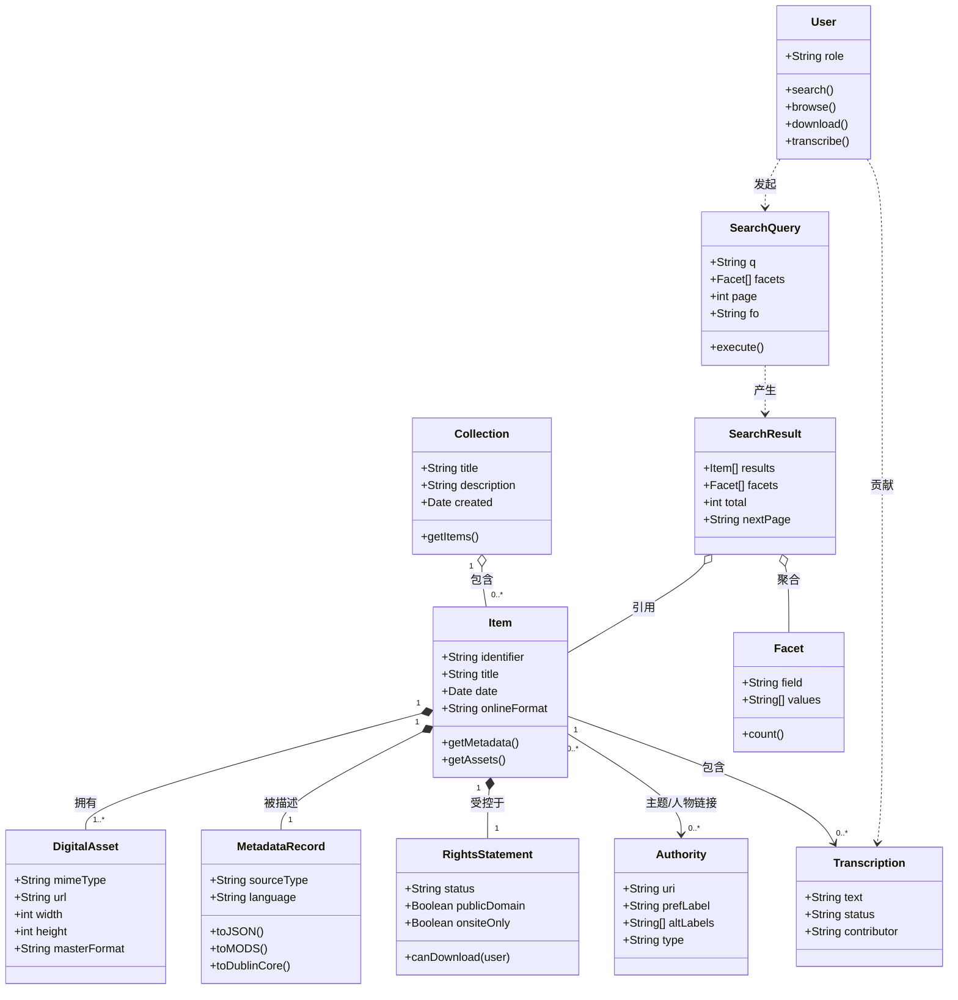
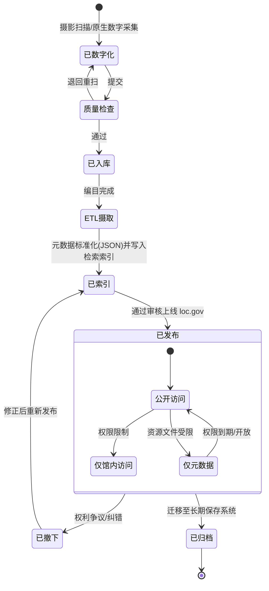
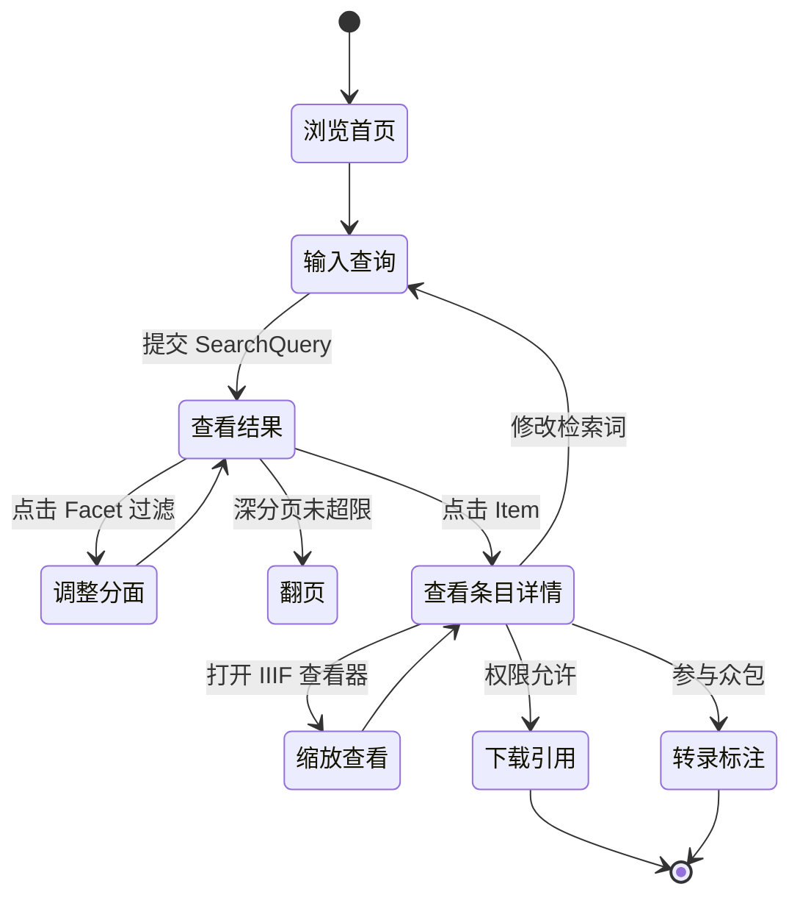
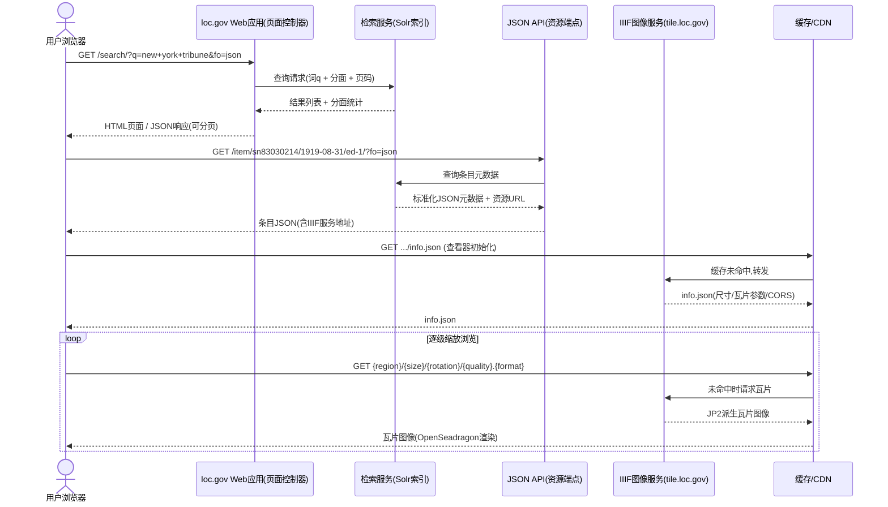
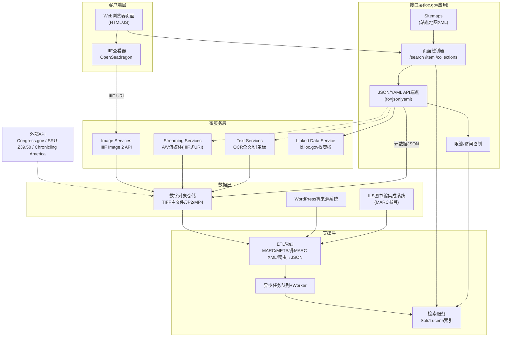

# 1113 作业：美国国会图书馆网站（loc.gov）系统分析

> 对照课程内容中**领域对象建模、系统应用架构设计、接口层设计**的原则、要求及案例，分析美国国会图书馆网站的**状态图、交互图、类图、构件图**及其**软件架构体系与设计模式**。
>
> 说明：本文基于 loc.gov 官方公开资料（API 文档、LC Labs 技术报告、官方博客）进行建模与分析，个别内部实现细节为依据公开接口反推的合理推断，已在文中注明。

---

## 一、系统概述

美国国会图书馆（Library of Congress，简称 LoC）网站 loc.gov 是世界上规模最大的数字图书馆门户之一，其核心业务包括：

1. **数字馆藏发布与检索**：图书、照片、地图、手稿、报纸、音视频、存档网站等数百万数字条目的在线浏览与全文检索；
2. **元数据服务**：以 MARC、METS、MODS、Dublin Core 等图书馆行业标准描述资源，并通过 ETL 过程统一为标准化 JSON 对外提供；
3. **开放 API 服务**：loc.gov JSON/YAML API、IIIF 图像服务、OCR 文本服务、流媒体服务、权威档链接数据服务（id.loc.gov）、SRU/Z39.50 检索服务等；
4. **公众参与**：众包转录（By the People）、图像标注与剪辑、教学资源复用等。

按照课程中"领域对象建模 → 系统应用架构设计 → 接口层设计"的思路，下文依次给出类图（领域模型）、状态图、交互图、构件图，并归纳其架构体系与设计模式。

---

## 二、领域对象建模与类图

### 2.1 建模思路

领域建模遵循课程中的原则：

- **以业务实体为中心**：先识别核心实体类（馆藏集合、条目、数字资源、元数据记录、检索、权限等），再识别边界类（页面、API 端点）与控制类（检索控制器、ETL 控制器）；
- **高内聚低耦合**：每个类职责单一，如"权限"独立成类而非散落在条目属性中；
- **可复用与可扩展**：元数据记录屏蔽 MARC/METS 等异构来源差异，对外呈现统一形态。

### 2.2 核心领域对象

| 领域对象 | 类型 | 职责 |
|---|---|---|
| Collection（集合） | 实体类 | 按主题组织的条目集合，由专家策划 |
| Item（条目） | 实体类 | 数字化馆藏的最小逻辑单位（一张照片、一段音视频、一份手稿等） |
| DigitalAsset（数字资源） | 实体类 | 条目的物理文件表示：TIFF 主文件、JP2 派生图、缩略图、MP4 音视频等 |
| MetadataRecord（元数据记录） | 实体类 | 描述性/书目元数据，屏蔽 MARC、METS、非 MARC XML、WordPress 等来源差异 |
| RightsStatement（权限声明） | 实体类 | 公有领域、受限访问、仅馆内访问等访问控制策略 |
| SearchQuery（检索请求） | 控制类 | 封装查询词、分面过滤、分页参数 |
| SearchResult（检索结果） | 实体类 | 结果列表、分面统计、分页信息（深分页限制 10 万条） |
| Facet（分面） | 实体类 | 原始格式、在线格式、日期、地点等过滤维度 |
| Authority（权威档/链接数据） | 实体类 | 人名、主题、地名等规范控制，以 URI 形式提供链接数据 |
| User（用户） | 参与者 | 浏览者、研究者、教育者、众包志愿者 |
| Transcription/Annotation（转录/标注） | 实体类 | 众包转录文本与 IIIF 图像标注 |

### 2.3 类图

**建模要点说明**：Collection 与 Item 是聚合关系（集合可独立于条目存在）；Item 与 DigitalAsset 是组合关系（资源文件依附于条目）；MetadataRecord 采用"来源中立"设计，是应对异构元数据（MARC/METS/WordPress 等）的关键抽象——这正是接口层"统一数据出口"在领域层的投影。

---

## 三、状态图

### 3.1 数字条目生命周期状态图

一条数字馆藏从数字化到在线发布的生命周期（依据 LC Labs 技术报告中"数字化 → 入库 → ETL → 上线"的公开流程描述建模）：

**状态迁移的触发事件**对应系统中的关键用例：ETL 摄取对应"元数据标准化"构件；权限检查对应 RightsStatement 的 `canDownload()`。

### 3.2 用户检索会话状态图

---

## 四、交互图（顺序图）

以"用户检索并在线查看一张历史报纸版面"为典型场景，覆盖检索服务、IIIF 图像服务两个核心链路：

**交互设计要点**（对照接口层设计原则）：

1. **一次请求双形态输出**：同一 URL 通过 `fo=json` 参数或内容协商返回 HTML 或 JSON/YAML——接口层"统一资源、多视图呈现"；
2. **URI 模板寻址**：IIIF 图像地址遵循 `{scheme}://{server}/{prefix}/{identifier}/{region}/{size}/{rotation}/{quality}.{format}` 规范（RFC 6570），路径参数而非查询参数，天然可缓存；
3. **关注点分离**：页面渲染、元数据查询、图像瓦片分别由不同构件负责，交互链路清晰。

---

## 五、构件图

依据官方公开的服务清单（JSON API、三大微服务、链接数据服务、SRU）与技术报告（ETL、检索索引）绘制：

**构件职责**：

- **接口层**：页面控制器与 JSON API 是同一应用的两种"皮肤"；限流构件保护后端（官方文档明确有无鉴权限流与 10 万条深分页限制）；
- **服务层**：Image/Text/Streaming 三个微服务各自独立部署扩展（官方博客记载 IIIF 图像服务从 2 台服务器扩至 6 台、峰值 30 请求/秒）；
- **支撑层**：ETL 管线把 ILS 的 MARC、特藏的 METS、非 MARC XML、网页爬虫、WordPress 等多源数据统一为标准化 JSON，经异步任务队列写入 Solr 检索索引；
- **数据层**：数字对象仓储保存 TIFF 主文件与 JP2/MP4 派生文件，是所有媒体服务的最终数据源。

---

## 六、软件架构体系

综合以上模型，loc.gov 的架构体系可概括为：**B/S 架构下"分层架构 + 微服务"混合风格，REST 风格接口层，批处理 ETL 数据管线**。

### 6.1 架构风格分析

| 维度 | 特征 | 证据 |
|---|---|---|
| 整体形态 | B/S 三层/多层架构 | 浏览器 → 接口层 → 服务层 → 数据层 |
| 服务组织 | 面向服务的微服务拆分 | 官方称"每个功能对应一个小的专注 API"，文本/图像/流媒体三个微服务独立演进 |
| 接口风格 | REST + 资源 URI | `/item/`、`/search/?q=...&fo=json`；IIIF URI 模板寻址 |
| 数据流 | 管道-过滤器（ETL） | 多源元数据 → 标准化 JSON → 检索索引，经异步队列解耦 |
| 可扩展性 | 无状态 + 水平扩展 + 缓存 | HTTP 无状态；IIIF 路径式 URI 便于 CDN/服务器缓存；图像服务横向扩容 |
| 标准兼容 | 图书馆行业标准全家桶 | IIIF、MARC、METS、MODS、Dublin Core、SRU/Z39.50、链接数据(URI) |

### 6.2 对照课程"系统应用架构设计"原则的评价

1. **分层清晰**：表现、接口、服务、数据各层职责明确，符合分层架构"每层只与相邻层交互"的要求；
2. **松耦合**：数据、服务、接口松耦合（LC Labs 实验项目报告明确以"数据松耦合 + 异步任务队列 + 多 Worker"为工作方式），接口层变更不影响数据仓储；
3. **可伸缩性优先**：公开 API 无需鉴权但有速率限制，用"限流 + 缓存 + 禁止深分页"保护系统稳定，是高负载公共服务的典型策略；
4. **演进式架构**：从 American Memory 等遗留平台逐步迁移到统一平台（Project One），体现架构演进而非推倒重建的思想。

---

## 七、设计模式分析

| 设计模式 | 应用位置 | 说明 |
|---|---|---|
| **MVC（模型-视图-控制器）** | loc.gov Web 应用 | 同一资源 URL 既能渲染 HTML 页面又能返回 JSON（`fo=json`），即同一模型配多视图 |
| **外观模式 Facade** | JSON API | 用一个统一端点封装后端 Solr 索引、元数据仓储、权限判断等复杂子系统，对外只暴露 `/search`、`/item` 等简洁接口 |
| **适配器模式 Adapter** | ETL 元数据标准化 | 把 MARC、METS、非 MARC XML、WordPress 等异构格式适配为统一 JSON 表达 |
| **策略模式 Strategy** | 多格式输出 | JSON / YAML / HTML / MODS / Dublin Core 等输出格式可按需切换，算法（序列化策略）互相替换 |
| **代理模式 Proxy** | 限流网关与 CDN 缓存 | tile.loc.gov 在客户端与图像服务之间充当保护代理与缓存代理 |
| **组合模式 Composite** | Collection–Item–Asset 层次 | 集合/条目/资源构成树形结构，客户端以一致方式访问 |
| **迭代器模式 Iterator** | 分页机制 | API 结果分页遍历（配合深分页限制，鼓励用分面过滤缩小范围） |
| **管道-过滤器 Pipeline** | ETL 管线 | 抽取→转换→加载逐步处理，各阶段可独立替换 |
| **工厂模式 Factory** | ETL 多源处理器 | 依据元数据来源类型（MARC/METS/爬虫等）创建对应的摄取处理器 |
| **模板方法 Template Method** | ETL 流程骨架 | 摄取流程的固定骨架（读取→解析→标准化→写索引），不同来源只重写解析细节 |
| **单例模式 Singleton** | 检索索引核心 | 全站共享一份 Solr/Lucene 索引实例，保证检索一致性 |

**典型组合**：一次"检索→展示"请求实际上串联了 MVC（页面渲染）→ Facade（API 门面）→ Proxy（限流/缓存）→ Iterator（分页）→ Adapter（元数据适配）多个模式，说明该系统在接口层设计上高度模式化，这是其能长期稳定支撑海量公开访问的重要原因。

---

## 八、接口层设计原则对照（课程要求）

1. **资源化与统一接口**：一切皆资源（条目、集合、图像、音视频段），统一用 HTTP GET + URI 访问；
2. **URI 语义化与稳定性**：条目 URI（`loc.gov/item/...`）、IIIF URI 模板（RFC 6570）均可长期引用，便于学术引用与外链嵌入；
3. **内容协商**：同一资源支持 HTML / JSON / YAML 多形态输出，"API 原本为驱动网站而生，同时服务于开发者"——接口与复用一体化设计；
4. **标准优先**：优先采用 IIIF、SRU/Z39.50、链接数据等国际标准而非私有协议，保证跨机构互操作；
5. **防护性设计**：无需 API key 降低使用门槛，但以速率限制、深分页上限、分面过滤引导等手段保障可用性；
6. **机器可读性**：`info.json` 自描述服务能力（尺寸、瓦片、CORS），支持客户端自动发现，接近 HATEOAS 思想。

---

## 九、总结

loc.gov 以**领域建模上"条目-集合-资源-元数据"的中立抽象**、**架构上"分层+微服务+REST"的混合体系**、**接口上"统一资源、多形态输出、标准兼容、防护性开放"**三者协同，构建了能持续支撑海量数字馆藏公开服务的系统。其设计充分印证了课程所强调的：好的领域模型是接口简洁的前提，接口层原则（资源化、无状态、可缓存）直接决定架构的可伸缩性，而设计模式则是在不牺牲清晰性的前提下组织复杂度的手段。

**主要参考**：
- Library of Congress, *APIs at the Library of Congress*（loc.gov/apis）：JSON API、微服务、SRU 等官方文档
- LC Labs, *Digital Scholarship at the Library of Congress* 技术报告：ETL 流程、数字化规模、深分页限制
- The Signal, *IIIF at the Library of Congress*：IIIF 服务部署规模与查看器实现
- The Signal, *Library of Congress on the Web*：API 演进史
