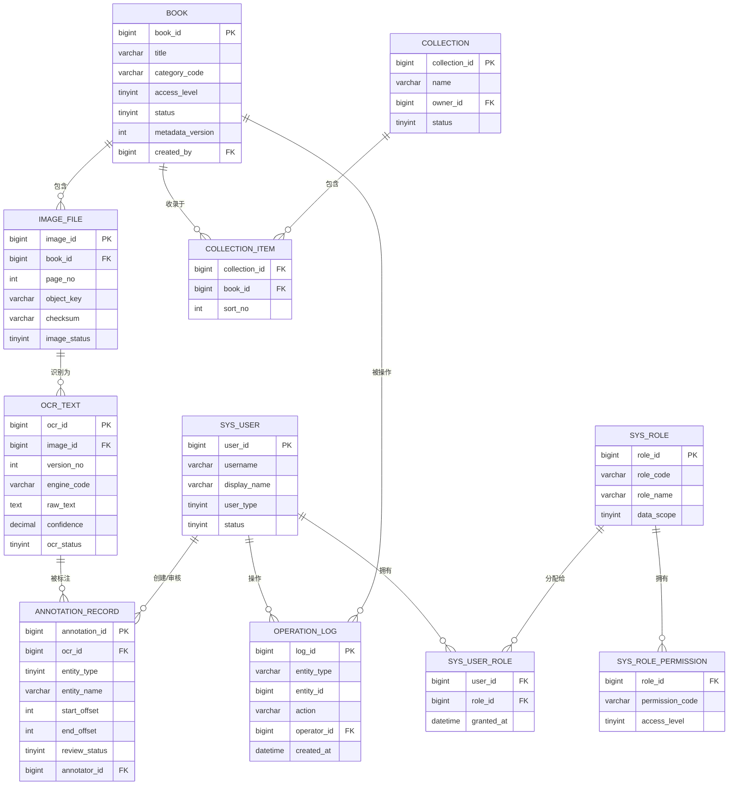

# 古籍文献数字化平台——面向服务设计与数据层设计

> 作业答复稿。设计目标：满足元数据著录、OCR 识别、实体标注、分级检索、专题汇编与上层系统对接；支持后续新增地方志、族谱等资源类型；OCR 引擎与数据库可替换。

---

## 问题 1：面向服务设计

### 1.1 服务边界划分

划分原则：**按业务能力划分，而不是按技术层次划分**；每个服务独占自己的数据，跨服务只通过契约或事件交互；基础能力下沉复用，编排层只做组合不实现能力。

| 层级 | 服务名称 | 核心职责 | 明确不做什么 | 解耦/复用价值 |
|---|---|---|---|---|
| 基础能力服务 | 认证与权限服务 `AuthService` | 登录、令牌校验、RBAC 角色权限；统一判定 `OPEN / INTERNAL / RESTRICTED` 三级访问 | 不碰古籍、影像、OCR 业务数据 | 所有服务共用一套权限口径，避免每个服务各写一套判断 |
| 基础能力服务 | OCR 识别服务 `OcrService` | 封装 OCR 引擎，提交识别任务，回传文本与置信度 | 不存元数据、不做审核、不关心古籍状态 | 引擎通过适配器注入，可替换；可被其他资源类型复用 |
| 基础能力服务 | 实体标注服务 `AnnotationService` | 人物/地名等实体识别、偏移量标注、候选实体规范化 | 不做审核、不持有古籍主数据 | 独立能力，检索与专题服务可直接调用 |
| 基础能力服务 | 审计日志服务 `AuditService` | 记录“谁、何时、修改了哪条记录”，保存前后快照；只追加 | 不判断业务规则、不修改业务表 | 集中留痕，满足约束 4 |
| 基础能力服务 | 消息事件总线 `EventBus` | 领域事件发布/订阅、失败重试、死信队列 | 不包含业务逻辑 | 时间解耦与扇出，满足约束 5 |
| 业务服务 | 古籍档案服务 `ArchiveService` | 古籍元数据 CRUD、版本、`category_code`、开放级别、状态管理 | 不存大图、不存 OCR 正文 | 元数据的唯一真相源，支持新增资源类型只扩枚举 |
| 业务服务 | 影像资源服务 `ImageService` | 影像注册、页码、对象键、校验值、生命周期 | 不做 OCR、不改元数据 | 大图与结构化数据分离，满足约束 1 |
| 业务服务 | 检索汇编服务 `SearchService` | 按权限检索元数据/OCR/标注，专题组装与数据集导出 | 不产生原始数据，只消费 | 统一检索出口，访客与研究人员看到的结果由权限过滤 |
| 业务服务 | 审核工作流服务 `ReviewService` | 标注结果审核、驳回、状态流转 | 不执行标注本身 | 质量门禁独立，职责不与标注服务重叠 |
| 编排服务 | 数字化流程编排 `WorkflowService` | 串接“上传→登记→OCR→标注→审核→发布” | 不实现具体能力 | 步骤可插拔，新增资源类型只需改流程定义 |
| 编排服务 | API 网关 / 上层对接 `GatewayService` | 对外聚合、鉴权、限流、协议转换，服务图书馆门户与成果系统 | 不持有业务数据 | 隔离外部系统，保护内部服务 |

**关键边界说明**

- `ArchiveService` 只管结构化元数据；影像在 `ImageService`，文本在 `OcrService`，标注在 `AnnotationService`，互不越界。
- `AuthService` 判定权限，`ArchiveService` / `SearchService` 只消费判定结果并做行级过滤。
- `AuditService` 只记录，不参与业务决策；业务服务通过本地事务或事务发件箱保证日志不丢。
- `OcrService` 与 `AnnotationService` 都是基础能力，既服务本平台，也可被上层系统或其他资源类型复用。

---

### 1.2 接口契约（任选 2 个服务）

#### 契约一：古籍档案服务 `ArchiveService.getBookDetail`

**服务职责**：在调用方权限范围内返回一本古籍的结构化元数据及摘要信息；不返回大图二进制和 OCR 全文。

**入参**

```json
{
  "requestId": "req-8c12f0",
  "bookId": "bk_10001",
  "caller": {
    "token": "eyJhbGciOi...",
    "roles": ["RESEARCHER"],
    "dept": "中文系"
  },
  "include": ["metadata", "imageList", "ocrSummary"]
}
```

**出参**

```json
{
  "code": 0,
  "message": "OK",
  "requestId": "req-8c12f0",
  "data": {
    "bookId": "bk_10001",
    "title": "地方志残卷",
    "dynasty": "清",
    "author": "佚名",
    "categoryCode": "LOCAL_GAZETTEER",
    "accessLevel": "INTERNAL",
    "status": "PUBLISHED",
    "metadataVersion": 3,
    "imageCount": 128,
    "ocrStatus": "REVIEWED",
    "updatedAt": "2026-11-20T10:15:00+08:00"
  }
}
```

**异常返回**

```json
{
  "code": 40301,
  "message": "ACCESS_DENIED",
  "requestId": "req-8c12f0",
  "data": {
    "bookId": "bk_10001",
    "requiredLevel": "RESTRICTED",
    "hint": "涉密文献仅允许档案管理员在可信终端访问"
  }
}
```

其他异常码：`40401 BOOK_NOT_FOUND`、`42201 INVALID_INCLUDE_FIELD`、`42901 TOO_MANY_REQUESTS`、`50301 METADATA_STORE_UNAVAILABLE`。

#### 契约二：OCR 识别服务 `OcrService.submitRecognition`

**服务职责**：接收影像引用，调度可替换 OCR 引擎完成识别，异步回传文本与置信度；不负责业务审核与持久化元数据。

**入参**

```json
{
  "requestId": "req-7f3a91",
  "imageId": "img_10001_001",
  "imageUri": "obj://ancient-books/bk_10001/p001.tif",
  "options": {
    "engine": "default",
    "language": "zh-Hans-ancient",
    "returnLayout": false,
    "callbackUrl": "https://internal/ocr/callback"
  }
}
```

**出参（受理成功）**

```json
{
  "code": 0,
  "message": "ACCEPTED",
  "data": {
    "taskId": "ocr_task_9b21",
    "status": "QUEUED",
    "estimatedSeconds": 45
  }
}
```

**完成事件（异步回调）**

```json
{
  "eventId": "evt_ocr_9b21",
  "eventType": "OCR_COMPLETED",
  "taskId": "ocr_task_9b21",
  "imageId": "img_10001_001",
  "data": {
    "ocrId": "ocr_30001",
    "text": "……识别正文……",
    "confidence": 0.936,
    "engineCode": "ancient-ocr",
    "engineVersion": "2.3"
  }
}
```

**异常返回**

```json
{
  "code": 50011,
  "message": "ENGINE_TIMEOUT",
  "requestId": "req-7f3a91",
  "data": {
    "taskId": "ocr_task_9b21",
    "retryable": true,
    "retryAfterSeconds": 10
  }
}
```

其他异常码：`40001 IMAGE_NOT_FOUND`、`40103 UNAUTHORIZED_CALLER`、`42901 ENGINE_BUSY`、`50012 ENGINE_UNAVAILABLE`。

> 两个契约都带 `requestId` / `eventId`，用于幂等去重和链路追踪，这是解耦后保证可靠性的必要设计。

---

### 1.3 服务解耦方式与同步/异步选择

**解耦手段**

1. **服务自治、数据隔离**：每个服务独占自己的库表，禁止跨服务直连数据库或跨库 JOIN。
2. **契约先行**：用版本化 JSON Schema / OpenAPI 定义接口，消费者按契约调用，内部实现可替换。
3. **端口与适配器**：OCR 引擎、对象存储、数据库都通过接口注入；换引擎、换库、换存储不改业务代码。
4. **事件驱动**：`BookMetadataChanged`、`OCR_COMPLETED`、`AnnotationApproved`、`BookPublished` 等事件经事件总线扇出给检索、审核、上层系统。
5. **横切能力集中**：鉴权、审计由基础服务统一提供，业务服务不重复实现。
6. **可靠性机制**：同步调用配超时、熔断、限流；异步调用配 `requestId/eventId` 去重、至少一次投递、死信队列、事务发件箱。

**同步 / 异步场景选择**

| 场景 | 调用方式 | 理由 |
|---|---|---|
| 查询古籍详情、检索首屏 | 同步 REST/gRPC | 用户在等待，需要强一致读，耗时短 |
| 修改元数据并返回版本号 | 同步 + 本地事务写审计 | 需要立即确认结果，避免并发覆盖 |
| 权限校验 | 同步（带缓存） | 每次请求必须通过，低延迟、可缓存 |
| 上传后触发 OCR | 异步 MQ | 耗时数十秒，失败可重试，不能阻塞上传 |
| OCR 完成后触发实体标注 | 异步 MQ | 依赖事件、长任务，可并行处理 |
| 标注提交后通知审核人 | 异步 MQ | 多订阅者，时间解耦 |
| 重建检索索引 | 异步 MQ | 最终一致即可，避免双写不一致 |
| 专题数据集导出 | 异步 + 回调下载链接 | 生成大文件慢，用户无需同步等待 |
| 上层系统数据同步 | 异步批量 MQ + 同步查询接口 | 削峰填谷，失败可重放 |

---

## 问题 2：数据层概念与逻辑模型设计

### 2.1 E-R 概念模型（实体—属性—关系清单）

**实体清单**

1. **古籍 `BOOK`**：`book_id`(PK)、`title`、`dynasty`、`author`、`category_code`、`access_level`、`status`、`metadata_version`、`created_by`(FK→SYS_USER)、`created_at`、`updated_by`(FK→SYS_USER)、`updated_at`
2. **影像文件 `IMAGE_FILE`**：`image_id`(PK)、`book_id`(FK)、`page_no`、`object_key`、`storage_provider`、`file_name`、`file_size`、`mime_type`、`checksum`、`image_status`、`created_by`(FK)、`created_at`
3. **OCR 文本 `OCR_TEXT`**：`ocr_id`(PK)、`image_id`(FK)、`version_no`、`engine_code`、`engine_version`、`raw_text`、`normalized_text`、`confidence`、`ocr_status`、`is_current`、`reviewed_by`(FK)、`reviewed_at`、`created_at`
4. **标注记录 `ANNOTATION_RECORD`**：`annotation_id`(PK)、`ocr_id`(FK)、`entity_type`、`entity_name`、`surface_text`、`start_offset`、`end_offset`、`confidence`、`source`、`review_status`、`annotator_id`(FK)、`reviewer_id`(FK)、`created_at`、`reviewed_at`
5. **用户 `SYS_USER`**：`user_id`(PK)、`username`、`display_name`、`user_type`、`dept`、`status`、`created_at`
6. **角色 `SYS_ROLE`**：`role_id`(PK)、`role_code`、`role_name`、`data_scope`
7. **用户角色 `SYS_USER_ROLE`**：`user_id`(FK,PK)、`role_id`(FK,PK)、`granted_by`(FK)、`granted_at`
8. **角色权限 `SYS_ROLE_PERMISSION`**：`role_id`(FK,PK)、`permission_code`(PK)、`access_level`(PK)
9. **操作日志 `OPERATION_LOG`**：`log_id`(PK)、`entity_type`、`entity_id`、`action`、`operator_id`(FK)、`operator_name`、`before_json`、`after_json`、`changed_fields`、`trace_id`、`created_at`
10. **专题 `COLLECTION`**：`collection_id`(PK)、`name`、`owner_id`(FK)、`status`、`created_at`
11. **专题条目 `COLLECTION_ITEM`**：`collection_id`(FK,PK)、`book_id`(FK,PK)、`sort_no`

**关系清单**

| 关系 | 基数 | 通过 |
|---|---|---|
| 古籍 → 影像 | 1 : N | `IMAGE_FILE.book_id` |
| 影像 → OCR 文本 | 1 : N | `OCR_TEXT.image_id` |
| OCR 文本 → 标注记录 | 1 : N | `ANNOTATION_RECORD.ocr_id` |
| 用户 → 标注记录 | 1 : N | `annotator_id` / `reviewer_id` |
| 用户 → 操作日志 | 1 : N | `operator_id` |
| 用户 ↔ 角色 | M : N | `SYS_USER_ROLE` |
| 角色 ↔ 权限项 | M : N | `SYS_ROLE_PERMISSION` |
| 古籍 ↔ 专题 | M : N | `COLLECTION_ITEM` |
| 古籍开放级别 + 角色权限 | 逻辑规则 | `BOOK.access_level` 与 `permission_code/access_level` 共同决定可见性 |

**E-R 图源码（Mermaid，可直接粘贴渲染）**



---

### 2.2 核心数据表设计

> 说明：`PK` 主键，`FK` 外键，`NN` 非空（NOT NULL）。字段类型以 MySQL 为例。

#### （1）古籍主表 `book`

| 字段 | 类型 | 键 | 非空 | 说明 |
|---|---|---|---|---|
| `book_id` | BIGINT | PK | 是 | 古籍唯一标识 |
| `title` | VARCHAR(255) | | 是 | 题名 |
| `dynasty` | VARCHAR(50) | | 否 | 朝代 |
| `author` | VARCHAR(100) | | 否 | 作者 |
| `category_code` | VARCHAR(32) | | 是 | 资源类型：古籍/地方志/族谱，便于扩展 |
| `access_level` | TINYINT | | 是 | 1 开放 / 2 校内 / 3 涉密 |
| `status` | TINYINT | | 是 | 0 草稿 / 1 审核中 / 2 已发布 / 3 归档 |
| `metadata_version` | INT | | 是 | 元数据版本，默认 1 |
| `created_by` | BIGINT | FK→sys_user.user_id | 是 | 创建人 |
| `created_at` | DATETIME | | 是 | 创建时间 |
| `updated_by` | BIGINT | FK→sys_user.user_id | 否 | 更新人 |
| `updated_at` | DATETIME | | 是 | 更新时间 |

**索引**：`PRIMARY(book_id)`；`INDEX idx_status_access(status, access_level)` 支撑列表按状态与权限过滤；`INDEX idx_category(category_code)` 支撑资源类型检索；`FULLTEXT(title, author)` 或前缀索引支撑题名/作者检索。

#### （2）影像文件表 `image_file`

| 字段 | 类型 | 键 | 非空 | 说明 |
|---|---|---|---|---|
| `image_id` | BIGINT | PK | 是 | 影像唯一标识 |
| `book_id` | BIGINT | FK→book.book_id | 是 | 所属古籍 |
| `page_no` | INT | | 是 | 页码 |
| `object_key` | VARCHAR(512) | | 是 | 对象存储键，不存二进制 |
| `storage_provider` | VARCHAR(32) | | 是 | COS/MinIO 等，便于替换 |
| `file_name` | VARCHAR(255) | | 是 | 原始文件名 |
| `file_size` | BIGINT | | 是 | 字节数 |
| `mime_type` | VARCHAR(64) | | 是 | 媒体类型 |
| `checksum` | VARCHAR(64) | | 是 | SHA-256，校验一致性 |
| `image_status` | TINYINT | | 是 | 0 已上传 / 1 待 OCR / 2 已识别 / 3 归档 |
| `created_by` | BIGINT | FK→sys_user.user_id | 是 | 上传人 |
| `created_at` | DATETIME | | 是 | 上传时间 |

**索引**：`PRIMARY(image_id)`；`UNIQUE uk_book_page(book_id, page_no)` 防重复页码；`INDEX idx_image_status(image_status)` 驱动 OCR 待办；`INDEX idx_object(object_key)` 便于存储对账。

#### （3）OCR 文本表 `ocr_text`

| 字段 | 类型 | 键 | 非空 | 说明 |
|---|---|---|---|---|
| `ocr_id` | BIGINT | PK | 是 | OCR 记录唯一标识 |
| `image_id` | BIGINT | FK→image_file.image_id | 是 | 来源影像 |
| `version_no` | INT | | 是 | 识别版本号 |
| `engine_code` | VARCHAR(32) | | 是 | 引擎标识，支持替换 |
| `engine_version` | VARCHAR(32) | | 是 | 引擎版本 |
| `raw_text` | MEDIUMTEXT | | 是 | 识别原文，与元数据分离 |
| `normalized_text` | MEDIUMTEXT | | 否 | 规范化文本 |
| `confidence` | DECIMAL(5,4) | | 是 | 整体置信度 |
| `ocr_status` | TINYINT | | 是 | 0 生成中 / 1 成功 / 2 失败 / 3 待校对 |
| `is_current` | TINYINT | | 是 | 是否当前版本，默认 0 |
| `reviewed_by` | BIGINT | FK→sys_user.user_id | 否 | 校对/复核人 |
| `reviewed_at` | DATETIME | | 否 | 复核时间 |
| `created_at` | DATETIME | | 是 | 生成时间 |

**索引**：`PRIMARY(ocr_id)`；`UNIQUE uk_image_version(image_id, version_no)`；`INDEX idx_current(image_id, is_current)` 快速取当前版本；`INDEX idx_ocr_status(ocr_status)`；`FULLTEXT(raw_text, normalized_text)` 支撑正文检索。

#### （4）标注记录表 `annotation_record`

| 字段 | 类型 | 键 | 非空 | 说明 |
|---|---|---|---|---|
| `annotation_id` | BIGINT | PK | 是 | 标注唯一标识 |
| `ocr_id` | BIGINT | FK→ocr_text.ocr_id | 是 | 关联 OCR 文本 |
| `entity_type` | TINYINT | | 是 | 1 人物 / 2 地名 / 3 时间 / 4 书名 |
| `entity_name` | VARCHAR(255) | | 是 | 标准化实体名 |
| `surface_text` | VARCHAR(255) | | 是 | 原文片段 |
| `start_offset` | INT | | 是 | 起始字符偏移 |
| `end_offset` | INT | | 是 | 结束字符偏移 |
| `confidence` | DECIMAL(5,4) | | 否 | 自动标注置信度 |
| `source` | VARCHAR(16) | | 是 | MANUAL / MODEL |
| `review_status` | TINYINT | | 是 | 0 待审核 / 1 通过 / 2 驳回 |
| `annotator_id` | BIGINT | FK→sys_user.user_id | 是 | 标注人 |
| `reviewer_id` | BIGINT | FK→sys_user.user_id | 否 | 审核人 |
| `created_at` | DATETIME | | 是 | 创建时间 |
| `reviewed_at` | DATETIME | | 否 | 审核时间 |

**索引**：`PRIMARY(annotation_id)`；`UNIQUE uk_anno(ocr_id, start_offset, end_offset, entity_type)` 防重复标注；`INDEX idx_entity(entity_type, entity_name)` 支撑按实体检索；`INDEX idx_review(review_status)` 驱动审核待办；`INDEX idx_annotator(annotator_id)`。

#### （5）用户权限表组

`sys_user`

| 字段 | 类型 | 键 | 非空 | 说明 |
|---|---|---|---|---|
| `user_id` | BIGINT | PK | 是 | 用户唯一标识 |
| `username` | VARCHAR(64) | UK | 是 | 登录名 |
| `display_name` | VARCHAR(64) | | 是 | 显示名 |
| `user_type` | TINYINT | | 是 | 1 档案管理员 / 2 研究人员 / 3 系统对接 |
| `dept` | VARCHAR(128) | | 否 | 院系，用于校内访问判定 |
| `status` | TINYINT | | 是 | 1 启用 / 0 停用 |
| `created_at` | DATETIME | | 是 | 创建时间 |

`sys_role`

| 字段 | 类型 | 键 | 非空 | 说明 |
|---|---|---|---|---|
| `role_id` | BIGINT | PK | 是 | 角色唯一标识 |
| `role_code` | VARCHAR(64) | UK | 是 | ARCHIVIST / RESEARCHER / VISITOR / INTEGRATION |
| `role_name` | VARCHAR(64) | | 是 | 角色名称 |
| `data_scope` | TINYINT | | 是 | 1 全部 / 2 校内 / 3 公开 |

`sys_user_role`（用户—角色关联）

| 字段 | 类型 | 键 | 非空 | 说明 |
|---|---|---|---|---|
| `user_id` | BIGINT | FK,PK(联合) | 是 | 用户 |
| `role_id` | BIGINT | FK,PK(联合) | 是 | 角色 |
| `granted_by` | BIGINT | FK→sys_user.user_id | 否 | 授权人 |
| `granted_at` | DATETIME | | 是 | 授权时间 |

`sys_role_permission`（角色—权限关联）

| 字段 | 类型 | 键 | 非空 | 说明 |
|---|---|---|---|---|
| `role_id` | BIGINT | FK,PK(联合) | 是 | 角色 |
| `permission_code` | VARCHAR(64) | PK(联合) | 是 | 如 BOOK_UPLOAD / OCR_RUN / ANNOTATION_REVIEW / DATA_EXPORT |
| `access_level` | TINYINT | PK(联合) | 是 | 该权限可访问的古籍级别 |

**索引**：各表主键；`uk_username`、`uk_role_code`；`sys_user_role` 另建 `INDEX idx_role(role_id)` 便于反查角色成员。

#### （6）操作日志表 `operation_log`

| 字段 | 类型 | 键 | 非空 | 说明 |
|---|---|---|---|---|
| `log_id` | BIGINT | PK | 是 | 日志唯一标识 |
| `entity_type` | VARCHAR(32) | | 是 | BOOK / IMAGE / OCR_TEXT / ANNOTATION |
| `entity_id` | BIGINT | | 是 | 被操作记录 ID |
| `action` | VARCHAR(64) | | 是 | METADATA_UPDATE / ANNOTATION_APPROVE 等 |
| `operator_id` | BIGINT | FK→sys_user.user_id | 否 | 操作人，系统/匿名可为空 |
| `operator_name` | VARCHAR(64) | | 是 | 操作人快照，防用户删除后丢失 |
| `operator_ip` | VARCHAR(64) | | 否 | 来源 IP |
| `before_json` | JSON | | 否 | 变更前快照 |
| `after_json` | JSON | | 否 | 变更后快照 |
| `changed_fields` | VARCHAR(512) | | 否 | 变更字段列表 |
| `trace_id` | VARCHAR(64) | | 否 | 链路追踪 ID |
| `created_at` | DATETIME | | 是 | 操作时间 |

**索引**：`PRIMARY(log_id)`；`INDEX idx_entity(entity_type, entity_id, created_at)` 查某条记录的历史；`INDEX idx_operator(operator_id, created_at)` 查某人的操作；`INDEX idx_action(action, created_at)` 按动作审计。日志表只允许 INSERT，不允许 UPDATE/DELETE。

#### （7）扩展：专题汇编

`collection(collection_id BIGINT PK, name VARCHAR(255) NN, owner_id BIGINT FK NN, status TINYINT NN, created_at DATETIME NN)`；`collection_item(collection_id BIGINT FK,PK, book_id BIGINT FK,PK, sort_no INT NN)`，索引 `INDEX idx_book(book_id)`。

**索引设计与检索需求的对应关系**：主检索入口是“题名/作者全文 → 状态+权限过滤 → 资源类型过滤 → 实体名检索 → 记录变更历史”，因此分别建立 `FULLTEXT`、`idx_status_access`、`idx_category`、`idx_entity`、`idx_entity(日志)`，避免全表扫描。

---

### 2.3 为什么古籍影像文件不直接存入数据库表

1. **体积与成本**：扫描影像是大文件，存成 BLOB 会让表急剧膨胀，备份、恢复、主从复制、迁库的成本远高于普通结构化数据。
2. **访问模式不同**：影像是大文件流式读取，对象存储天然支持分片上传、断点续传、CDN 缓存和冷热分层；数据库不擅长这种吞吐。
3. **生命周期不同**：元数据需要强事务和版本控制，影像需要长期归档与生命周期策略，OCR 文本需要全文检索；分开存才能分别扩展。
4. **权限隔离更稳**：可在对象存储的 bucket/前缀策略上再做一层访问控制，涉密影像不进入公共检索索引，满足三级权限隔离要求。
5. **可替换性**：表中只保存 `object_key + storage_provider + checksum`，更换对象存储或数据库时只需改适配器，不动业务表结构。
6. **保护事务性能**：大对象写入会拉长数据库事务与 WAL/binlog，影响元数据登记和审计日志这类需要强一致的操作。

---

## 评分点对照（自检）

| 评分点 | 对应设计 |
|---|---|
| 服务高内聚低耦合、职责不重叠 | 三层服务清单中每列都写明了“不做什么”；元数据/影像/OCR/标注分属不同服务 |
| 可复用 | OCR、标注、权限、审计、事件总线均为基础能力服务，可供其他资源类型复用 |
| 接口契约清晰 | 两个契约均给出服务名称、职责、入参、出参、异常码，并带 `requestId/eventId` |
| 同步/异步判断合理 | 同步用于即时读与强一致写；异步用于 OCR、标注、索引、导出等长耗时可重试场景 |
| 实体识别完整、关系合理 | 11 个实体 + 9 类关系，含 M:N 关联表 |
| 范式规范 | 大文本独立表、实体名/原文片段分列、通过关联表消除多对多冗余 |
| 索引贴合检索 | 全文索引、权限+状态联合索引、实体索引、日志时间索引均对应实际检索场景 |
